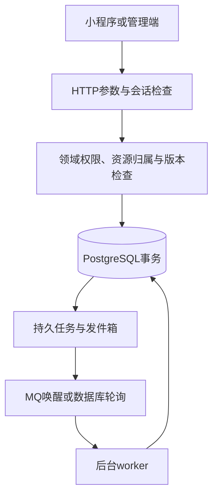

# 后端功能链路与本地业务联调

本文介绍当前后端实现，区分业务代码、运行装配和外部能力验收。入口为 Go HTTP API，后台由独立 worker 执行；PostgreSQL 保存业务权威状态，Redis 提供共享限流，RocketMQ 提供任务唤醒，数据库任务支持补偿。

## 1. 通用请求链路



HTTP 层负责严格参数检查及状态映射，服务层判断业务规则，repository 执行查询。写操作统一检查当前会话、账号生命周期、资格、岗位、资源归属、幂等键及期望版本。相同幂等键与相同请求不重复产生业务结果；同键异体拒绝。重放仍重新授权，不把历史成功当成当前权限。

`version` 是资源或聚合状态版本，`content_version` 是正文版本；修改正文使旧审核失效。后台审核任务还拥有自己的版本，不能相互替代。响应202只表示请求持久接收，不能解释为审核、送达或物理清理完成。

## 2. 微信登录、会话与本人状态

`wx.login code → 后端向微信交换OpenID → 内部身份解析与账号建立 → 数据库会话提交 → 返回token和本人投影`。

同一登录请求受重复交换控制，外部交换不占用数据库事务；数据库只保留会话摘要，退出后即时失效。`GET /api/v1/me` 根据当前会话、生命周期、认证及处罚重新投影，并给出可用动作。修改本人昵称、隐藏身份标签不允许修改学号、认证状态或后台角色。微信登录成功不等于学生认证通过。

真实微信适配已有实现；配置存在不等于完成真实微信、双账号、开发者工具或真机验收。本地业务模式也不提供伪造微信登录路由。

## 3. 学生卡与学生认证

`本人上传 → 图片大小/像素/格式检查 → 规范化及加密对象持久化 → 扫描任务 → card-worker → 本人查询扫描状态 → 提交姓名/学号/已通过扫描的学生卡 → 后台审核 → 认证资格更新`。

图片扫描通过只表示材料可进入认证；学生卡必须属于当前本人。审核通过同时处理学号唯一占用与加密身份绑定；驳回重提使用当前申请版本，旧申请不能覆盖新决定。学生卡对象不返回公开下载地址。

本地图片扫描和学校规则为开发适配，材料归属、图片资源限制、学号唯一约束及人工审核仍执行；不代表学校权威或真实扫描供应商已验收。

## 4. 心愿生命周期

| 状态 | 含义 |
| --- | --- |
| draft | 私有草稿 |
| pending_review / rejected | 待审核／驳回 |
| ready | 已通过审核但未上架 |
| published | 已上架接受应愿 |
| matching | 已确定应愿人 |
| realized | 已确认实现 |
| fulfilled | 已提交还愿故事，公开仍须独立审核 |
| withdrawn / expired | 已撤下／已过期 |

正常链路：`保存草稿 → 显式送审 → 内容worker或人工复核 → ready → 作者显式上架 → published`。审核批准不自动上架。

正文最多500字，有效期1～30天；同一作者最多3条活跃心愿，应愿中仍占额度。上架时在作者锁下重新计算额度、期限、审核精确版本及资格。改稿产生新版本并重新审核；修改公开心愿或撤下时使未终结申请失效。公开读取实时核对状态、作者资格、到期时间、限制及隐私屏障，只返回已批准投影。

## 5. 应愿、匹配与普通回退

`B浏览A心愿 → B提交加密留言及看到的正文版本 → 留言审核 → A读取当前有效已审申请 → A同意 → 原子确定唯一应愿人 → 建立独立匹配和会话`。

待审留言不能同意；检查双方资格、拉黑、心愿有效性及版本。并发同意只能成功建立一个当前匹配，其他未终结申请失效。申请者可撤销未匹配申请。

重新招募结束旧匹配，旧会话只读，新匹配新建会话。已实现回退到应愿中可在资格及额度允许时恢复原匹配，但不复活已取消的待审消息。刷新期限需要新的内容版本和重新审核。

## 6. 私聊与站内通知

`当前匹配参与者发送 → 检查会话写入代次 → 原文加密持久化及审核工作 → 分析/人工审核 → 锁内重新检查双方资格及关系 → 分配送达序号 → 同事务站内通知 → 接收方增量读取`。

未完成审核不分配送达号，重复消费不重复消息或通知；空页不推进读取序号。结束匹配、确认实现、拉黑或处罚会联动写权限并取消失效任务。任一方注销后阻断相关历史读取；内容限制不会让已送达序号倒退。

提供会话列表、已送达消息增量、发送、本人消息状态、通知列表及带版本已读。私聊保留主动发送的联系方式；不提供任意账号私聊、消息编辑删除或管理员任意搜索。外部微信通知尚未接入，站内通知独立可用。

## 7. 确认实现、还愿故事、分享与公开主页

`matching → 许愿人确认实现 → realized并关闭会话写入 → 提交故事 → fulfilled → 当前故事审核通过 → 公开与分享`。

提交故事成功即已还愿，不等于故事公开。改稿立即隐藏旧公开版本，新稿重新审核；撤回不恢复招募或聊天写入。分享保存目标引用，每次打开重验当前资格，不用旧快照绕过撤回或限制。

`GET /api/v1/users/{id}/public-profile` 按公开时间与ID分页返回当前可见心愿和已审故事；私有草稿、待审内容不进入公开列表，标签受当前隐藏设置约束。

## 8. 树洞文字、身份与昵称

`私有草稿 → 选择身份 → 提交审核及发布意图 → 扫描/人工分流 → 精确当前版本批准 → 公开`。与心愿不同，树洞送审包含发布意图，批准后可公开，无独立上架动作。撤回或改稿使旧任务和公开投影失效，晚到审核不能重新公开。

支持匿名、半匿名标签、已审昵称三档。匿名同帖别名稳定，跨帖不提供账号关联标识；半匿名标签必须由用户显式选择且字典有效；新昵称先作为候选审核，未批准不替换旧生效昵称。缺年级字典时半匿名不可用，不伪造标签。

发帖需要已认证资格；受罚、注销和限制由每次当前授权控制，不依赖客户端隐藏按钮。

## 9. 暖评、抱抱与树洞通知

已登录未认证用户可在规则允许范围内暖评，帖子提交仍须认证。暖评创建即送审，绑定父帖正文版本和评论代次；改评隐藏旧投影。关闭评论阻止新增公开并取消待审项，重新开启不补发已取消任务。首次公开仅生成一次非本人通知，改稿不会重复通知；失效目标不回显旧正文。

抱抱采用设置目标态而非单纯加减计数：已抱抱或未抱抱，附独立版本。重复请求不累加，计数不为负，旧版本不能重新点亮；不公开互动者列表。

## 10. 本人时空胶囊

`填写正文与服务端预约时间 → 明确接受安全告知 → 加密封存 → 私密分类审核及预约任务 → 到期且审核批准 → 本人详情读取`。

正文最多500字，预约60秒～365天，活动额度20个；创建、列表、提前读取均不返回正文，即使到期列表仍无正文。到期未批准仍不可读，客户端改时间不能解锁。到期调度支持停机补偿，通知失败不阻合法读取；取消或删除后旧任务不能复活。普通处罚不阻本人合法读取或清理；危机内容另走隔离。

## 11. 审核、规则与危机

三类规则为危机、涉校、普通违规。词库完整快照通过后台显式创建发布，head并发代次与快照状态版本相互独立。分析在事务外进行，写入结果时重新检查版本、资格、屏障和取消状态；后台批准不能覆盖业务已经取消的事实。

普通审核岗只处理当前合法案件。危机由命中或授权人工升级触发：`即时隔离 → 独立加密证据 → 危机案件及关怀/通知待办 → 危机岗接手、跟进、结案或误报回退`。读取证据先执行授权与审计，不提供普通审核岗任意读取私密内容的入口。误报回普通审核，不直接恢复公开。

## 12. 拉黑、举报、处罚与申诉

拉黑及解除、举报、固定等级处罚、服务端30秒警告确认、受限本人申诉均有实现。轻微违规警告，一般违规禁言7天，严重违规封禁；同一违规动作不因重复请求反复处罚。处罚联动内容公开、匹配、会话和待审任务，解罚不直接复活违规内容。

匿名黑名单切换后使用随机条目标识，旧目标账号接口返回升级要求；切换不可逆，关闭树洞也不回退。后台超管、审核岗、危机岗每次按当前角色检查，角色撤销后旧请求不能借幂等回执继续执行。

## 13. 注销、证据删除与恢复

`本人确认和账号版本 → 持久删除意图 → 撤销会话及隐私屏障 → 关系处理 → 异步清理 → 实际完成后更新匿名回执`。202仅受理，屏障先于物理清理生效。

账号与限定证据分别清理，注销不越权清除独立证据；超管针对明确证据范围单独发起删除。缺外部全版本清理器时保持processing。幸存作者内容提供安全候选后仍需重新编辑审核，不能恢复原串。恢复扫描包含已确认意图，在开放读取/外发前重删。

## 14. 本地业务测试模式

显式 `LocalTest=true` 仅允许integration，生产拒绝。所有业务模块共用一个 `DatabaseDSN`；服务端仍按真实会话、资格、岗位、归属、版本和幂等授权。数据库登录不授超级用户、绕过RLS、建库、建角色或DDL；此模式不提供数据库层岗位隔离验收。

树洞不再要求HTTPS网关、CA、令牌或外部KMS，改用进程内测试适配：随机持久本机密钥加密，原文强制人工审核，危机通知未配置则保留待办。无外部对象的数据库清理可执行；含学生卡等外部对象时仍保持processing，不伪报全副本清理。删除意图使用同目录外置加密文件和进程间锁，支持重启，但不代表独立灾备资源或90天恢复验收。

联系方式只需设置 `Contact`，供本地关怀资料使用；空值不生成假号码。公众援助目录和年级字典缺失时仍降级为不可用，既有客户端契约不伪造“正式核验通过”。

首次启用前，已有业务环境应已完成0026、permissions、三类测试词库发布及opaque切换。先停止所选应用，再显式初始化：

```sh
make dev-stop
make dev-business-init
make dev-doctor
# 以下分别在独立终端运行
make dev-api
make dev-worker
make dev-content-worker
make dev-whispers-worker
make dev-privacy-worker
make dev-evidence-worker
```

本地私有文件为 `.local/local/business.simple.json`、`whispers-local.json` 与 `local-business-journal.json`；原 `business.json` 保留。初始化复用历史用途密钥与账号，首次缺少树洞用途密钥才随机生成，重跑不重置。普通启动不迁移或建身份。旧恢复日志非空时拒绝直接换空文件日志，需要先显式迁移意图。

旧内容worker与树洞worker分开运行；账号和证据worker读取同一树洞配置。`dev-stop`跟踪六个进程并等待退出，保留所有基础设施和卷。`LIYUANCI_LOCAL_SIMPLE_BUSINESS_FILE`、`LIYUANCI_LOCAL_WHISPERS_FILE`记录所选私有文件，派生宿主配置不改变原始密钥。

### MQ复用

可复用现有NameServer、Broker、地址与凭据，不再部署第二套MQ。树洞审核与解锁保留独立topic、生产组、消费组；配置模板为 `configs/examples/whispers-review-mq.yaml`、`whispers-unlock-mq.yaml`，主题须显式建立。

首轮设置 `DatabasePolling=true`，两个MQ文件留空即可运行；切MQ时设为false并提供两份配置。无MQ时仍有持久任务，但轮询通过不等于树洞MQ验收通过。

## 15. 如何理解“已实现”和“通过”

代码存在、编译成功、接口返回202、healthz=200均不能替代全业务验收。区分单元测试、隔离PG/Redis/MQ集成、实际服务HTTP、真实微信和页面、真机及生产外部资源。

本地模式保留实际业务状态机与授权，明确替代外部审核/密钥能力；不把本地图片扫描、人工测试审核、关怀占位状态或文件日志写成正式供应商、真实通知、全副本清理和生产灾备验收。

## 16. 当前验证范围

本地单DSN模式已通过组合API、原文人工树洞审核、胶囊提前隐藏/到期本人读取、注销访问撤销、文件删除日志及恢复门禁的真实PG/Redis集成检查；测试学生身份为隔离fixture，不是微信登录。原正式分角色及HTTPS供应商测试入口继续保留。

本机固定入口为 `http://127.0.0.1:18080`，当前本地模式healthz/readyz、树洞配置/列表和公开心愿查询返回200；匿名Me返回401。六个进程正常运行；原超管、审核岗、危机岗重新登录和岗位403隔离通过，重复初始化保持账号、原配置及持久密钥不变。

`readyz=200`在本地模式只表示已装配测试依赖可用，不代表真实微信、外部审核/通知/清理、正式资料、真机或生产验收。联系方式当前留空，年级标签和公众援助目录保持缺失降级。
