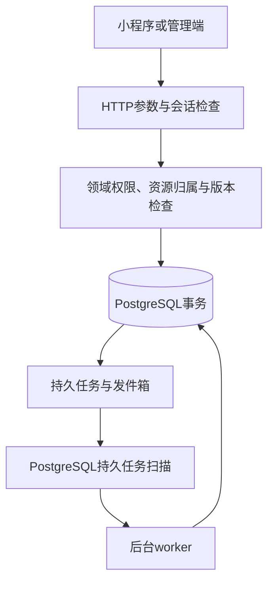

# 后端功能链路与本地业务联调

本文介绍当前后端实现，区分业务代码、运行装配和外部能力验收。入口为 Go HTTP API，后台由独立 worker 执行；PostgreSQL保存业务权威状态和持久任务，Redis提供共享限流和公开候选缓存；无MQ和Docker运行依赖，所有环境只使用一组database分项配置；岗位授权由业务会话和领域函数执行。

## 1. 通用请求链路

HTTP 层负责严格参数检查及状态映射，服务层判断业务规则，repository 执行查询。写操作统一检查当前会话、账号生命周期、资格、岗位、资源归属、幂等键及期望版本。相同幂等键与相同请求不重复产生业务结果；同键异体拒绝。重放仍重新授权，不把历史成功当成当前权限。

`version` 是资源或聚合状态版本，`content_version` 是正文版本；修改正文使旧审核失效。后台审核任务还拥有自己的版本，不能相互替代。响应202只表示请求持久接收，不能解释为审核、送达或物理清理完成。

## 2. 微信登录、会话与本人状态

`wx.login code → 后端向微信交换OpenID → 内部身份解析与账号建立 → 数据库会话提交 → 返回token和本人投影`。

同一登录请求受重复交换控制，外部交换不占用数据库事务；数据库只保留会话摘要，退出后即时失效。`GET /api/v1/me` 根据当前会话、生命周期、认证及处罚重新投影，并给出可用动作。修改本人昵称、隐藏身份标签不允许修改学号、认证状态或后台角色。微信登录成功不等于学生认证通过。

真实微信适配已有实现；配置存在不等于完成真实微信、双账号、开发者工具或真机验收。本地业务模式也不提供伪造微信登录路由。

## 3. 学生卡与学生认证

`本人上传 → 图片大小/像素/格式检查 → 规范化及加密对象持久化 → 扫描任务 → worker → 本人查询扫描状态 → 提交姓名/学号/已通过扫描的学生卡 → 后台审核 → 认证资格更新`。

图片扫描通过只表示材料可进入认证；学生卡必须属于当前本人。审核通过同时处理学号唯一占用与加密身份绑定；驳回重提使用当前申请版本，旧申请不能覆盖新决定。学生卡对象不返回公开下载地址。

正式图片安全扫描仅腾讯云CI明确通过才批准。`Result=2`（疑似）与 `Result=1`（违规）均持久化为 `scan_status=rejected`，本次扫描任务结束，提示用户重新上传；不自动重试、不进入人工图片复核，该材料不能用于提交学生认证。接口超时、错误或不完整响应属于故障，才进入持久重试与耗尽关注流程。学校权威校验直接通过；材料归属、图片资源限制、学号唯一约束及人工认证审核仍执行。

## 4. 心愿生命周期

| 状态 | 含义 |
| --- | --- |
| draft | 私有草稿 |
| pending_review / rejected | 待审核／驳回 |
| ready | 已通过审核但未上架 |
| published | 已上架接受应愿 |
| matching | 已确定应愿人 |
| realized | 已确认实现 |
| fulfilled | 已提交还愿故事，公开仍须独立审核 |
| withdrawn / expired | 已撤下／已过期 |

正常链路：`保存草稿 → 显式送审 → 内容worker或人工复核 → ready → 作者显式上架 → published`。审核批准不自动上架。

心愿具有独立标题、正文和报答字段；正文最多500字，有效期1～30天；同一作者最多3条活跃心愿，应愿中仍占额度。上架时在作者锁下重新计算额度、期限、审核精确版本及资格。改稿产生新版本并重新审核；修改公开心愿或撤下时使未终结申请失效。公开读取实时核对状态、作者资格、到期时间、限制及隐私屏障，只返回已批准投影。

## 5. 应愿、匹配与普通回退

`B浏览A心愿 → B提交加密留言及看到的正文版本 → 留言审核 → A读取当前有效已审申请 → A同意 → 原子确定唯一应愿人 → 建立独立匹配和会话`。

待审留言不能同意；检查双方资格、拉黑、心愿有效性及版本。并发同意只能成功建立一个当前匹配，其他未终结申请失效。申请者可撤销未匹配申请。

重新招募结束旧匹配，旧会话只读，新匹配新建会话。已实现回退到应愿中可在资格及额度允许时恢复原匹配，但不复活已取消的待审消息。刷新期限需要新的内容版本和重新审核。

## 6. 私聊与站内通知

`当前匹配参与者发送 → 检查会话写入代次 → 原文加密持久化及审核工作 → 分析/人工审核 → 锁内重新检查双方资格及关系 → 分配送达序号 → 同事务站内通知 → 接收方增量读取`。

未完成审核不分配送达号，重复消费不重复消息或通知；空页不推进读取序号。结束匹配、确认实现、拉黑或处罚会联动写权限并取消失效任务。任一方注销后阻断相关历史读取；内容限制不会让已送达序号倒退。

提供会话列表、已送达消息增量、发送、本人消息状态、通知列表及带版本已读。每条已送达消息附 `viewer_is_sender` 当前读取者本人标记，同条消息对双方返回相反值，不返回发送者账号标识。私聊保留主动发送的联系方式；不提供任意账号私聊、消息编辑删除或管理员任意搜索。外部微信通知尚未接入，站内通知独立可用。

## 7. 确认实现、还愿故事、分享与公开主页

`matching → 许愿人确认实现 → realized并关闭会话写入 → 提交故事 → fulfilled → 当前故事审核通过 → 公开与分享`。

提交故事成功即已还愿，不等于故事公开。改稿立即隐藏旧公开版本，新稿重新审核；撤回不恢复招募或聊天写入。分享保存目标引用，每次打开重验当前资格，不用旧快照绕过撤回或限制。

`GET /api/v1/users/{id}/public-profile` 按公开时间与ID分页返回当前可见心愿和已审故事；私有草稿、待审内容不进入公开列表，标签受当前隐藏设置约束。

## 8. 树洞文字、身份与昵称

`私有草稿 → 选择身份 → 提交审核及发布意图 → 扫描/人工分流 → 精确当前版本批准 → 公开`。与心愿不同，树洞送审包含发布意图，批准后可公开，无独立上架动作。撤回或改稿使旧任务和公开投影失效，晚到审核不能重新公开。

支持匿名、半匿名标签、已审昵称三档。完全匿名公开昵称为“小鲤鱼”，跨帖不提供账号关联标识；半匿名标签必须由用户显式选择且字典有效；新昵称先作为候选审核，未批准不替换旧生效昵称。缺年级字典时半匿名不可用，不伪造标签。

发帖需要已认证资格；受罚、注销和限制由每次当前授权控制，不依赖客户端隐藏按钮。

## 9. 暖评、抱抱与树洞通知

已登录未认证用户可在规则允许范围内暖评，帖子提交仍须认证。暖评创建即送审，绑定父帖正文版本和评论代次；改评隐藏旧投影。关闭评论阻止新增公开并取消待审项，重新开启不补发已取消任务。首次公开仅生成一次非本人通知，改稿不会重复通知；失效目标不回显旧正文。

抱抱采用设置目标态而非单纯加减计数：已抱抱或未抱抱，附独立版本。重复请求不累加，计数不为负，旧版本不能重新点亮；不公开互动者列表。

## 10. 本人时空胶囊

`填写正文与服务端预约时间 → 明确接受安全告知 → 加密封存 → 私密分类审核及预约任务 → 到期且审核批准 → 本人详情读取`。

正文最多500字，预约60秒～365天，活动额度20个；创建与提前读取不返回正文；本人列表仅向已解锁合规记录提供前三个码点摘要，全文仅从本人详情读取。到期未批准仍不可读，客户端改时间不能解锁。到期调度支持停机补偿，通知失败不阻合法读取；取消或删除后旧任务不能复活。普通处罚不阻本人合法读取或清理；危机内容另走隔离。

## 11. 审核、规则与危机

自定义规则分为危机、涉校、普通违规，另有内置词库。所有文字同时扫描已发布的一致快照；内置高/中风险默认转人工复核，低风险默认只记录命中提示；未命中且非隐私/危机重审，直接以原文/显式身份标签自动通过；命中保留原文转人工复核或危机隔离，分类由词库决定。私聊和胶囊涉校转复核但不生成公开涉校标签；私密胶囊仍只分类、按预约解锁。词库完整快照通过后台显式创建发布，head并发代次与快照状态版本相互独立。分析在事务外进行，写入结果时重新检查版本、资格、屏障和取消状态；后台批准不能覆盖业务已经取消的事实。

普通审核岗只处理当前合法案件。危机由命中或授权人工升级触发：`即时隔离 → 独立加密证据 → 危机案件及站内关怀待办 → 危机岗接手、跟进、结案或误报回退`。读取证据先执行授权与审计，不提供普通审核岗任意读取私密内容的入口。误报回普通审核，不直接恢复公开。

## 12. 拉黑、举报、处罚与申诉

拉黑及解除、举报、固定等级处罚、服务端30秒警告确认、受限本人申诉均有实现。轻微违规警告，一般违规禁言7天，严重违规封禁；同一违规动作不因重复请求反复处罚。处罚联动内容公开、匹配、会话和待审任务，解罚不直接复活违规内容。

匿名黑名单切换后使用随机条目标识，旧目标账号接口返回升级要求；切换不可逆，关闭树洞也不回退。后台超管、审核岗、危机岗每次按当前角色检查，角色撤销后旧请求不能借幂等回执继续执行。

## 13. 注销、证据删除与恢复

`本人确认和账号版本 → 持久删除意图 → 撤销会话及隐私屏障 → 关系处理 → 异步清理 → 实际完成后更新匿名回执`。202仅受理，屏障先于物理清理生效。

账号与限定证据分别清理，注销不越权清除独立证据；超管针对明确证据范围单独发起删除。外部全版本清理器已退役，不再作为数据库清理完成的前置依赖；回执不证明COS、供应商留存或备份已删除。幸存作者内容提供安全候选后仍需重新编辑审核，不能恢复原串。恢复扫描包含已确认意图，在开放读取/外发前重删。

## 14. 配置与本地业务模式

应用通过Viper读取configs/common.yaml和私有环境覆盖。应用自身只配置顶层masterkey，按环境和用途派生子密钥；密码、真实微信及可选外部对象凭据仍独立填写。密钥管理及身份摘要本机执行，图片由腾讯云CI同步审核，未配置或故障失败关闭；学校校验直接通过。内容只走词库，未命中直接通过，命中或重审保留原文复核；外部危机通知及全副本删除服务已移除，站内危机处置和关怀保留。正式对象存储使用腾讯云COS原生协议，密文不可覆盖，应用摘要版本读取时完整校验；未配置时对象读写不可用。账号及证据清理回执只表示数据库清理完成，不证明外部对象和备份已删除。全部业务模块从database分项配置生成连接并注入同一账号，学生、普通审核、危机岗位及超管仍按当前业务会话、归属、版本和幂等规则授权。数据库账号拥有专用业务库，但不拥有集群管理权限；普通启动不执行DDL。

所有后台任务使用PostgreSQL持久扫描，保留到期、租约、重试、attention、幂等及关闭等待。删除意图使用共享的加密文件账本，保存已确认意图以复核数据库恢复后的重删；账本不随业务库一并回滚。历史密钥与意图不能用空文件替换。

详细配置和启动顺序见[配置说明](CONFIGURATION.md)与[README](README.md)。

## 15. 资料广场、内容发现与后台能力

资料支持分类/年级筛选、正文与外链、私有COS文件上传/替换/短效下载，以及当前内容版本的四类反馈汇总。后台必须先下架再编辑；文件预约和归属版本用于幂等及孤立对象回收。

心愿、还愿故事和悄悄话支持关键词搜索、时间/累计热度排序；心愿和悄悄话提供最近七天榜单。心愿详情打开逐次计入浏览量，有效应愿同时参与计分；悄悄话按有效抱抱与可见暖评计分。Redis仅缓存候选定位和排序，每次公开投影仍复核数据库资格。后台查询及Markdown导出只返回授权的当前公开素材。

后台支持本地账号/岗位、本人改密、同源HttpOnly Cookie恢复、六项统计及北京时间日/月趋势。模块使用说明通过独立草稿和发布快照管理，学生按发布版本读取及确认。头像和资料孤立文件具有独立命名空间清理，不扩展匿名删除回执的范围。

## 16. 如何理解“已实现”和“通过”

代码存在、编译成功、接口返回202、healthz=200都不代替全业务验收。单测、隔离PG/Redis集成、实际Go进程、真实微信和页面、手机及生产外部资源需分别说明。

## 17. 当前验证范围

2026-11-08本地审核的18类原生集成、39个必需顶层用例通过，验证了单DSN完整API与五类worker诊断、学生卡与心愿审核、树洞/暖评/抱抱/胶囊、任务重试/关闭/恢复、业务岗位隔离和文件删除日志门禁。供应商与微信主体为隔离合成夹具，不是正式供应商验收。

MQ和Docker相关实现、配置、CI入口及本机项目资源已删除；不保留兼容模式。腾讯云COS/CI适配已实现，既有部署与开发联调证据见[后端现状](../docs/development/backend/README.md)。当前目标机状态、外部留存/删除策略、独立恢复、手机全链路与容量须单独核验。

## 共享字典管理

展示字典覆盖资料反馈、内置词库标签、认证与限制状态、管理员角色、资料状态、心愿状态，以及树洞审核、举报、危机和投递状态。后台任一有效岗位可读，超级管理员可在版本与幂等校验后修改中文名称和排序，资料反馈可停用；业务代码及其授权含义不随展示编辑变化。

举报类型直接维护现有业务表，提供新增、发布、停用能力。树洞配置每次从数据库读取已发布类型，普通举报提交继续复核已发布代码；后台保留停用历史标签。发布、全局版本和前后值审计在同一命令事务内完成，公开展示只暴露名称和状态，不包含管理员信息。

本轮新增功能已通过 `make check`、`make build` 和完整 `make integration`（19类专项、40个必需顶层用例）。举报代码按既有契约限制为1–32位ASCII字母、数字、下划线或连字符；补齐边界后另行通过字典/HTTP单测及隔离字典专项。新增0018仅应用于本轮临时测试库，现有环境仍需显式升级；年级字典继续保留原有资源YAML与历史版本语义。
