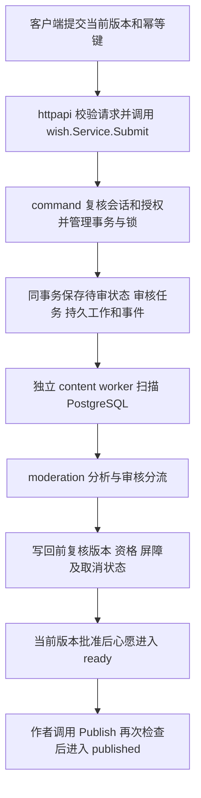

# 鲤愿池 Go 后端

Go API 与独立后台任务进程，使用 PostgreSQL 保存业务数据和持久任务，Redis 提供共享限流。当前为 `codex/simplify-backend` 简化分支：仅原生运行，数据库只配置一组 `database` 分项字段，由程序生成唯一连接，业务权限由学生/后台会话、岗位角色及领域函数执行。

业务能力见 [FUNCTIONALITY.md](FUNCTIONALITY.md)，字段、覆盖规则与配置说明见 [CONFIGURATION.md](CONFIGURATION.md)，项目现状见 [后端文档](../docs/development/backend/README.md)。

## 新开发者指南

本文面向第一次接触项目的后端开发者。建议先理解业务主线，再跟读一个真实请求，最后按下文启动开发环境并完成一次小改动。当前工程只有一个 Go module：`github.com/calm195/liyuanci-backend-go`。

### 先理解项目在做什么

鲤愿池面向校园用户，核心是通过认证的学生发布心愿、其他学生应愿、双方匹配沟通并完成还愿；同时提供匿名树洞、本人时空胶囊、资料广场，以及后台认证、审核和安全治理。

| 业务 | 正常流程 | 开发时必须保留的规则 |
| --- | --- | --- |
| 账号与认证 | 微信登录 → 学生卡上传/扫描 → 提交认证 → 后台审核 | 登录成功不等于认证通过；材料必须属于本人；后台会话与学生会话分开 |
| 心愿与应愿 | 草稿 → 送审 → 审核通过 → 作者上架 → 应愿留言审核 → 同意匹配 | 审核通过只到 `ready`；上架需再次检查资格、有效期和活跃额度；一个心愿只能有一个当前匹配 |
| 聊天与还愿 | 匹配会话 → 消息审核送达 → 确认实现 → 提交故事 → 故事审核公开 | 没有任意账号私聊；未审核消息不可送达；故事提交与故事公开是两个结果 |
| 悄悄鲤 | 树洞送审并表达发布意图 → 审核公开 → 暖评/抱抱 | 树洞批准后可公开，没有心愿的单独上架步骤；匿名接口不能暴露账号关联 |
| 时空胶囊 | 接受安全告知 → 加密封存 → 私密审核 → 到期后本人读取 | 到期且批准才可读；列表始终不返回正文；停机后任务需要补偿 |
| 资料广场 | 认证用户查询/复制/反馈；后台维护分类与资料 | 资料下线后才能编辑；链接和提取码加密；后端不抓取外部网盘 |
| 审核、安全与隐私 | 内容分流 → 人工复核或危机隔离；举报 → 处罚/申诉；注销 → 异步清理 | 普通审核岗与危机岗权限不同；解除处罚不复活内容；删除受理不等于清理完成 |

详细状态、限制和回退规则见 [业务链路](FUNCTIONALITY.md)。需求与有效契约从 [模块索引](../docs/modules.md) 查起；实现状态和外部依赖分别看 [现状](../docs/development/backend/README.md)、[缺口](../docs/development/backend/defects.md) 和 [计划](../docs/development/backend/plan.md)。有源码实现不等于已通过真实供应商、真机或生产验收。

### 按这个顺序读代码

| 顺序 | 阅读入口 | 要回答的问题 |
| --- | --- | --- |
| 1 | [cmd/server/main.go](cmd/server/main.go) → [app/server.go](internal/app/server.go) | 参数和退出信号怎样进入应用？配置、资源和 HTTP 宿主怎样启动与关闭？ |
| 2 | [app/services.go](internal/app/services.go)、[services_interaction.go](internal/app/services_interaction.go) → [routes.go](internal/app/routes.go) | 服务依赖如何注入？哪些 HTTP 接口被显式注册？ |
| 3 | [httpapi/wish_lifecycle.go](internal/httpapi/wish_lifecycle.go) → [wish/lifecycle.go](internal/modules/wish/lifecycle.go) | 一个请求怎样完成参数解析、授权、事务与状态变更？ |
| 4 | [wish/state.go](internal/modules/wish/state.go)、[repository.go](internal/modules/wish/repository.go) 与同目录测试 | 哪些状态转换合法？数据从哪里读取？失败时应保持什么不变？ |
| 5 | [contentreview/protocol.go](internal/modules/contentreview/protocol.go) → [moderation/worker.go](internal/modules/moderation/worker.go) | 送审之后，独立 worker 如何取得任务并安全写回结果？ |
| 6 | [entity](internal/entity)、[迁移说明](migrations/README.md)、[架构检查](internal/app/architecture_test.go) | 表模型、SQL 和包依赖分别由谁维护？ |

每个业务包先看 `doc.go`，再看用例文件及其测试。包内按职责分文件：`service` 构造服务，`query`/`commands` 或具体业务文件组织用例，`repository` 保存查询，`worker` 处理异步工作；并非每个包都具有相同文件名。完整目录和模块检索表见 [代码组织](#7-代码组织与重构边界)。

日常定位可以从接口或业务动作反向查找，不必从头阅读整个工程：

```sh
rg -n 'submit-review|/wishes' internal/httpapi internal/app
rg -n 'func .*Submit|func .*Publish' internal/modules/wish
rg --files internal/modules/wish -g '*_test.go'
```

### 跟读一次“心愿送审到上架”



1. HTTP 路由为 `POST /api/v1/wishes/:id/submit-review`。处理器读取会话、幂等键、`expected_version` 和 `content_version`，负责输入校验与 HTTP 错误映射。
2. `wish.Service.Submit` 进入 `lifecycle.go` 的变更流程；`command` 执行当前身份、资源归属、锁和幂等控制，`wish.Policy` 判断状态与版本。业务变化、审核任务和持久工作在同一事务提交。
3. 事务提交后，另一个进程中的内容 worker 独立处理任务，HTTP 受理响应不等待审核完成。`durable` 管理持久任务协议，`workrunner` 管理扫描、取消和排空，`moderation.Worker` 负责内容分析与审核分流。需要人工复核时，不能把扫描完成当成审核批准。
4. 分析结果可能晚于编辑、撤回、处罚或注销。写回时必须重新检查当前状态，旧审核不能覆盖新正文或取消事实。普通内容审核协议集中在 `contentreview`，历史任务名 `wish_review` 和事件名 `wish.review_requested` 保持稳定。
5. 当前版本批准后，作者另行调用 `Publish`；上架在锁内再次检查额度、资格、期限和审核版本。公开列表由查询路径重新判断可见性，不直接返回私有表模型或解密原文。

读其他模块时也沿着“HTTP → 领域用例 → 事务/存储 → 持久任务 → 结果投影”查找。并非每个接口都有异步步骤；跨模块状态变化通过显式事务协作函数完成，不能绕过所属模块直接修改其表。

### 跑通第一个开发环境

先安装 Go 1.25+ 和 Python 3；业务运行还需要已启动的原生 PostgreSQL、Redis，以及管理员创建的专用业务库和普通应用账号。应用账号拥有本库对象，但不能有超级用户、BYPASSRLS 或集群管理权限。第一次准备按下面顺序操作，已有环境从配置核对开始，不重复生成配置或初始化数据。

```sh
python3 -m pip install --target .local/tools/python -r scripts/requirements.txt
make build
make configure               # 仅首次创建；已有文件时拒绝覆盖
# 编辑 configs/development.yaml，填写本地数据库、Redis及所需凭据
make check-config            # 离线校验配置
make migrate                 # 显式修改所选开发库结构及权限
make init                    # 显式初始化首个后台账号和检索引用
make doctor                  # 连接依赖诊断，不启动HTTP监听
make run                     # 前台API，默认地址127.0.0.1:8080
```

API 运行后，在另一个终端执行 `make wordlists`，通过后台鉴权接口显式发布开发词库。后台初始登录名和口令从私有开发配置读取；不要将其写进文档或日志。根据功能分别启动以下 worker，每条命令占用一个终端或独立进程：

| 命令 | 负责的工作 |
| --- | --- |
| `make worker KIND=card` | 学生卡扫描 |
| `make worker KIND=content` | 心愿、应愿、故事、聊天等普通内容审核 |
| `make worker KIND=whispers` | 树洞、昵称、暖评审核及胶囊任务 |
| `make worker KIND=account` | 账号注销清理 |
| `make worker KIND=evidence` | 独立证据清理 |

树洞还需要显式启用 `whispers` 开发配置及屏蔽策略，步骤见 [初始化与启动](#3-初始化与启动)。配置合并、相对路径与模式区别见 [CONFIGURATION.md](CONFIGURATION.md)。所有进程使用同一环境文件与 `masterkey`；已有数据时不能随意换环境名或主密钥。

如果只想确认 Go 程序能启动，可在构建后运行 `bin/server -config configs/common.yaml`，只提供健康端点。`/healthz` 是进程存活，`/readyz` 反映已装配依赖；健康模式没有业务路由。业务开发需要私有配置，真实学生登录需要微信能力，本地没有伪造微信登录接口；先做规则或接口开发时可直接运行不依赖中间件的单测。

### 从一个需求进入开发流程

1. **确认范围和基线。** 核对本仓库与 docs 的分支、完整 HEAD 和工作区；当前在 `codex/simplify-backend`，保护已有改动。按模块索引找到需求/契约，再从模块 `doc.go` 和现有用例确认输入、输出、资格、状态与失败语义。
2. **确定改动所属层。** 请求解析与状态码放 `httpapi`；业务规则和状态转换放所属 `modules`；查询放 repository 并使用 `WithContext`；接口定义在使用方，具体 Redis/HTTPS 实现放 `adapters`，由 `app` 显式注入。配置字段放 `config`，通过 `app` 转换为领域参数；新协作依赖要说明用途并更新架构检查。
3. **实现一个完整用例。** 同时考虑成功、权限不足、旧版本、重复请求、资源归属，以及异步结果晚到。复用 `command` 的授权/锁/幂等机制和 `durable` 的租约/重试机制；运行操作通过注入的 `*zap.Logger` 记录中文结构化完成日志，失败也保留完成记录，不记录凭据、正文或个人数据。
4. **涉及表结构时同步维护。** 更新独立实体、`internal/migration/models.go` 清单和明确的版本 SQL；表及每个字段都要有中文 `COMMENT ON`。当前未上线基线按九组管理，首次交付前按授权调整，交付后只追加迁移；`permissions` 只管权限，不定义结构。普通 API/worker 不执行 DDL，不使用 AutoMigrate。详见 [迁移说明](migrations/README.md)。
5. **先做相关验证，再执行交付检查。** 按下表选择命令，失败修复后复跑。单测覆盖业务行为与拒绝路径，异步变更补取消、重试和旧结果不能复活资源等场景；不要用健康检查代替业务验证。
6. **更新说明并交付。** 同步受影响的运行说明和 docs 后端现状、缺陷、计划三份滚动文档，写清源码完整 SHA、实际验证和未测边界。获得当次提交授权后，先提交源码，再补 docs 精确版本；采用 Conventional Commits。提交、推送和部署分别按授权执行。

编写代码时，把密集初始化、长调用和查询按语义展开；长函数或深层回调按业务职责抽取具名函数。阶段切换、事务与锁边界、状态分流和失败恢复处补充中文注释，说明作用与原因；路由表和状态矩阵可集中保留。测试与脚本遵循相同原则，完整约定见 [AGENTS.md](AGENTS.md)。

| 改动阶段或类型 | 检查命令与范围 |
| --- | --- |
| 心愿模块日常迭代示例 | `make check-fast PACKAGES=./internal/modules/wish/...`；同时运行受影响的 HTTP、装配等相关包 |
| Go 代码或依赖完整交付 | `make fmt` → `make check` → `make build`；依赖变化先 `go mod tidy`，同步 `go.mod`/`go.sum` |
| 启动、装配或 Python 入口 | 增加 `python3 -m unittest discover -s scripts -p 'test_*.py' -v` 和受影响的原生集成 |
| 数据库、Redis、持久任务 | 显式运行 `make integration`，依赖宿主的 `initdb`、`pg_ctl`、`psql`、`redis-server`；脚本创建并清理本轮临时实例 |
| 纯文档 | 运行 docs 文档工具测试、文档/链接/固定指纹检查与 `git diff --check`；不需要重跑 Go 全量测试 |

`make check` 包含只读格式检查、`go vet ./...`、`go test -race -cover ./...`。未提供隔离依赖时部分集成用例可跳过，因此它不能代替 `make integration`；原生集成使用真实 PG/Redis，但供应商仍是隔离合成夹具。

### 常见卡点从哪里查

| 现象 | 排查起点 |
| --- | --- |
| 健康接口正常，业务接口404 | 确认是否用 `common.yaml` 启动了基础模式；核对私有配置的模式及 `app/routes*.go` 注册 |
| 业务始终待审或胶囊不解锁 | 确认对应 worker 已启动且配置一致，再查词库发布、人工复核状态、预约时间与任务重试/取消；不要手改数据库状态 |
| 登录后仍不能发帖或上架 | 分别核对认证、处罚、本人归属、当前状态及版本；微信会话只代表已登录 |
| 修改后遇到版本冲突 | 重新读取当前资源，按契约使用新的期望版本；不要绕过版本检查或重放旧审核结果 |
| 启动报结构或权限错误 | 核对所选数据库、应用账号与显式迁移结果；普通启动不会补表，也不会自动修复结构漂移 |
| 删除停留在处理中 | 查账号/证据 worker、外部清理能力和恢复门禁；受理回执不代表完成，不清空删除账本 |

开发中始终保留三条边界：PostgreSQL 是权威状态；客户端按钮、旧会话或幂等回执不能代替当前授权；异步成功必须对应仍然有效的当前业务版本。更多运行与工程细节按需查阅下文。

## 1. 配置结构

```text
configs/
  common.yaml                 # 公共默认值及中文注释
  development.example.yaml    # 开发覆盖模板，无真实秘密
  production.example.yaml     # 生产覆盖模板，无真实秘密
  development.yaml            # 私有开发覆盖，Git忽略
  production.yaml             # 私有生产覆盖，Git忽略
  wordlists.yaml              # 词库种子数据
  resources.yaml              # 公开资料模板，投放前核验
```

所有 Go 进程通过 Viper 先读取环境文件旁的 `common.yaml`，再递归合并指定环境 YAML；映射逐字段覆盖，数组整体替换。口令、密钥、令牌、CA 均内联私有环境文件，不读取环境变量或独立秘密文件。资源和状态的相对路径以配置目录解析。

应用自身只维护顶层 `masterkey`（32字节随机值的Base64），内部按环境和用途派生密钥，不再填写 `sessionkey`、`wrapkey` 等字段。数据库/Redis密码、微信和供应商凭据仍独立填写。所有进程必须使用同一环境及主密钥；已有数据时不可直接更换，详见[配置说明](CONFIGURATION.md)。

## 2. 本地准备

安装 Go 1.25+、Python 3、PostgreSQL 和 Redis。在仓库目录执行：

```sh
python3 -m pip install --target .local/tools/python -r scripts/requirements.txt
make build
make configure
```

`configure` 只新建不存在的私有配置：开发主密钥 `masterkey` 与初始化口令一次生成，已有文件拒绝覆盖。随后填写 `configs/development.yaml` 的 `database.host/port/name/user/password`、Redis 地址和所需凭据。应用账号应拥有专用业务数据库，禁止超级用户、BYPASSRLS、建库/建角色及复制权限；数据库及账号由数据库管理员事先创建。

`make configure CONFIG=configs/production.yaml ENVIRONMENT=production` 只复制空秘密模板，正式主密钥及外部凭据由操作者填写；已有数据不能直接更换主密钥。

## 3. 初始化与启动

```sh
make check-config            # 离线检查，不连接依赖、不创建目录
make migrate                 # 显式迁移及应用账号权限配置
make init                    # 显式初始化检索引用与首个后台账号
make run                     # 前台API；Ctrl-C正常退出
```

在另一个终端执行 `make wordlists`，通过后台鉴权接口发布词库。需要悄悄鲤时填写 `whispers` 的开发配置，并显式启用不透明屏蔽策略：

```sh
bin/migrate -config configs/development.yaml opaque-blocks
```

后台任务分别在终端或服务管理器中运行，所有进程共用同一环境文件：

```sh
make worker KIND=card
make worker KIND=content
make worker KIND=whispers
make worker KIND=account
make worker KIND=evidence
```

开发图片扫描使用明确的本地模拟；普通内容默认人工模式；缺少真实微信、通知、清理供应商的能力保持不可用或待办。普通启动不迁移、不初始化账号、不重置任务或替换密钥。停止 API/worker 不停止 PostgreSQL、Redis。

## 4. 检查与集成

```sh
make check-fast PACKAGES=./internal/config/...
make fmt
make check                    # 格式只读检查、go vet、race/coverage
python3 -m unittest discover -s scripts -p 'test_*.py' -v
make integration              # 真实、一次性的原生PG/Redis与实际Go进程
```

`integration` 需要宿主安装 `initdb`、`pg_ctl`、`psql`、`redis-server`。它创建随机端口及临时集群，使用独立测试账号，退出后清理本轮进程和数据。供应商由隔离 TLS 夹具替代；通过不等于正式供应商、手机或生产容量验收。

集成脚本核对Go结构化结果：既有四个专项的10个顶层必需用例必须实际执行、全部通过且测试包正常完成；用例缺失、顶层或子用例跳过、失败及无法解析的结果均不能报成功。普通`make check`仍允许未提供隔离依赖的集成用例跳过，不能单独作为真实中间件验收。

`/healthz` 表示进程存活，`/readyz` 表示已装配业务依赖可用。`make doctor` 连接依赖检查装配，不监听 HTTP。仅检查健康入口时可运行 `bin/server -config configs/common.yaml`。

## 5. 完整生产装配与上线流程

### 制品配置与进程

生产使用同一个 `configs/production.yaml`，包含唯一一组数据库分项配置、鉴权 Redis、微信、HTTPS 网关、一个应用 `masterkey`、外部 KMS 引用及独立删除账本路径。填写真实版本化资料；默认空秘密与未核验资源不能用于上线。网关实现见 [business.go](internal/adapters/gateway/business.go) 和 [gateway.go](internal/adapters/gateway/gateway.go)，涵盖身份检索、KMS、对象、学校规则、图片/文本分析、通知、脱敏及全副本清理。

```sh
make check-config CONFIG=configs/production.yaml
make migrate CONFIG=configs/production.yaml
make init CONFIG=configs/production.yaml
bin/migrate -config configs/production.yaml opaque-blocks
make doctor CONFIG=configs/production.yaml
make run CONFIG=configs/production.yaml
# 分别启动card/content/whispers/account/evidence，以下为其中一个进程：
make worker CONFIG=configs/production.yaml KIND=content
```

数据库账户权限不区分学生或后台岗位；请求必须经过当前会话、账号状态及岗位授权函数。普通审核不能取得危机权限，学生不能调用后台方法。DB 账号拥有本库结构以支持同 DSN 显式迁移，普通 API/worker 不自动执行 DDL。

已有多账号数据库切换时，管理员先将业务对象所有权转给应用账号，并撤销不用的历史 LOGIN；当前迁移入口不会自动修改服务器或删除旧数据库。历史版本 SQL 与校验和不改写。

## 6. 无MQ原生生产装配

当前分支已删除 MQ、Dockerfile、Compose、镜像构建和旧多进程凭据生成器；不保留兼容通道。仅构建 Go 二进制，并通过前台命令或目标机已有服务管理器管理进程。所有任务使用 PostgreSQL 到期扫描，保留租约、重试、幂等及失败待办。

删除意图存放在独立加密文件账本。API、相关 worker 必须使用相同账本路径与恢复密钥；目录权限 `0700`、文件 `0600`。账本使用跨进程锁、原子替换和 fsync，不清空已确认记录。恢复业务数据库时先运行：

```sh
bin/business-worker -config configs/production.yaml -kind account -recover
bin/business-worker -config configs/production.yaml -kind evidence -recover
```

恢复完成前不开放读取和外发。文件账本与业务库是否具有独立故障域、灾备和真实全副本删除仍需目标环境验收。本分支没有执行部署、服务管理器安装或生产迁移。

## 7. 代码组织与重构边界

工程使用单个Go module，`cmd/`的8个入口只负责参数、信号和退出状态。`internal`按职责归为10个一级目录；`modules`和`execution`只作路径分类，不包含汇总包。

```text
internal/app/                  # 服务构造、入口装配、资源生命周期
internal/config/               # 应用配置值、严格校验及稳定派生入口
internal/httpapi/              # HTTP路由、请求校验、响应映射
internal/modules/              # 账号认证、心愿、聊天、树洞、治理、资料
internal/execution/command/    # 授权复核、事务、跨域锁序和幂等
internal/execution/durable/    # 持久任务、租约、重试及恢复
internal/execution/workrunner/ # 扫描调度、取消和排空
internal/platform/             # 数据库/Redis客户端、日志、心跳
internal/platform/yamlconfig/  # 独立Viper实例、YAML读取与合并
internal/platform/securedata/  # 加密、对象读取和兼容用途派生
internal/adapters/gateway/     # 正式HTTPS供应商及微信身份交换
internal/adapters/local/       # 本地运行适配
internal/adapters/redis/       # 登录及树洞限流接口的Redis实现
internal/entity/               # 纯ORM表模型
internal/migration/            # 显式迁移、业务模型清单和版本SQL
internal/testconfig/           # 隔离集成测试的YAML输入
```

业务包保留原包名，按实际职责使用service、query、commands、repository和worker等文件；复杂功能以crisis、capsule等前缀聚合。每个业务包的doc.go说明入口、数据归属和协作边界。资料广场与审核继续在所属包内按职责分文件。

| 查找内容 | 起点与协作 |
| --- | --- |
| 学生/后台登录、资格与材料 | modules/studentauth、adminauth、identity、studentcard、verification |
| 心愿、申请、匹配、还愿和私聊 | modules/wish、chat；审核通过与业务上架分开 |
| 树洞、暖评、抱抱、胶囊 | modules/whisper；审核和安全策略显式协作 |
| 审核、危机、处罚、申诉 | modules/moderation、safety；跨模块效果保持同事务与锁顺序 |
| 删除、脱敏、恢复前重删 | modules/privacy；独立文件账本保存删除意图 |
| 资料查询、分类、维护、反馈 | modules/resourceplaza |
| 普通内容审核工作与结果协议 | modules/contentreview；心愿、应愿、故事、聊天与审核共用 |
| 匿名黑名单协议切换 | modules/blockpolicy；仅显式初始化切换 |

配置只依赖两个指定平台叶子包，由app显式转换领域参数和资源快照，保留可选字段、nil/空数组与复制隔离。业务接口由使用方定义，具体适配器不依赖配置或app；app负责选择实现。执行包不反向依赖具体业务模块。

共享审核协议集中在[contentreview](internal/modules/contentreview/protocol.go)，聊天通过该协议发布任务和返回结果，不导入心愿实现。历史任务标识`wish_review`、`wish.review_requested`保持原值；审核的[CursorPage](internal/modules/moderation/projection.go)由审核模块持有，保留空页面继续翻页和nil/空数组语义。command承载项目共享的授权、锁与幂等协议，稳定错误仍由HTTP和多模块统一识别；它不是通用工具包。

微信Exchanger的HTTPS实现位于[gateway/wechat.go](internal/adapters/gateway/wechat.go)，登录Limiter的Redis实现位于[authrate](internal/adapters/redis/authrate/limiter.go)。领域只接收接口，app注入具体实现；架构检查拒绝Redis/Gin/Viper和直接YAML解析回流业务模块。删除账本保留在privacy的现有恢复边界内，锁、原子替换、fsync和历史意图协议不因目录调整改写。

完整路径白名单见[架构检查](internal/app/architecture_test.go)，逐包登记跨模块协作，禁止业务回引app、config、httpapi、adapters和migration。entity保持叶子包，65项业务模型清单位于[models.go](internal/migration/models.go)；实体清单仅用于字段存在性校验和整体空库回退保护，不执行AutoMigrate。64张业务表由9组版本SQL管理，技术账本独立定义。新增表同步模型、清单、版本SQL和中文对象注释，结构、权限与回退流程见[迁移说明](migrations/README.md)。

应用装配从[services.go](internal/app/services.go)读取显式依赖与配置，按身份、互动、治理分别构造服务，再由[routes.go](internal/app/routes.go)注册HTTP。树洞的构造与注册分别位于[services_whisper.go](internal/app/services_whisper.go)和[routes_whisper.go](internal/app/routes_whisper.go)。[api_runtime.go](internal/app/api_runtime.go)统一API结构检查、共享依赖和两域恢复准入，完整业务与独立树洞入口组合这些组件；API、worker和初始化共用[resources.go](internal/app/resources.go)的资源构造规则。

宿主拥有自己打开的数据库、Redis和供应商资源，借用服务不得自行关闭；停止时先排空请求和后台任务，再逆序释放。普通启动不执行DDL。命令参数、HTTP契约、YAML字段与相对路径规则、密钥派生标签、任务协议、删除账本和恢复门禁属于兼容边界。

相关迭代使用`make check-fast PACKAGES=./internal/modules/模块/...`；完整交付执行`make fmt`、`make check`、`make build`。装配与入口变动增加Python入口测试和受影响的原生集成。`make integration`通过临时PG/Redis执行runtime、resourceplaza、moderation、migration四类专项，逐项拒绝缺失、跳过或失败的必需用例，退出清理本轮实例和数据；供应商使用合成夹具，不代表生产或真机验收。
